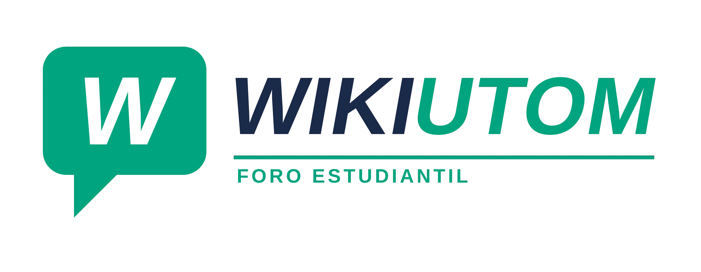

<div align="center">



# 📚 Wiki UTOM

### El portal y foro colaborativo de la comunidad estudiantil de la **Universidad Tecnológica del Oriente de Michoacán**

*Pregunta, comparte material y entérate de todo lo que pasa en la UTOM — en un solo lugar.*

<br />


<br />


</div>

---

## 🎯 Propósito

En la UTOM la información importante suele quedar dispersa entre grupos de WhatsApp, publicaciones sueltas y PDFs que nadie encuentra. **Wiki UTOM** nace para resolverlo: un espacio **hecho por y para estudiantes** donde el conocimiento se queda guardado y es fácil de encontrar.

- 🤝 **Colaboración entre carreras**: conecta a estudiantes de **TI, Biotecnología, Mercadotecnia y Gastronomía**.
- 📂 **Conocimiento que perdura**: guías de estudio, apuntes y materiales disponibles para las siguientes generaciones.
- 📢 **Información oficial al alcance**: convocatorias, becas, reinscripciones y avisos en un mismo lugar.
- 🔐 **Comunidad confiable**: acceso con correo institucional `@utom.edu.mx` o matrícula.

---

## ✨ Funcionalidades

| | Funcionalidad | Descripción |
|---|---|---|
| 🔑 | **Inicio de sesión institucional** | Acceso con correo `@utom.edu.mx` o matrícula, y recuperación de contraseña. |
| 🧵 | **Foro por categorías** | Hilos de TI, Biotecnología, Mercadotecnia, Gastronomía, Convocatorias y Preguntas Frecuentes. |
| 🔎 | **Búsqueda y filtros** | Encuentra hilos por título, contenido o etiquetas (`#Horarios`, `#Material`…). |
| 👍 | **Votos y comentarios** | Vota las mejores aportaciones y participa en la conversación. |
| 🔥 | **Tendencias y avisos oficiales** | Destaca hilos populares y publicaciones oficiales de la universidad. |
| 🔔 | **Notificaciones** | Respuestas, menciones, avisos y hilos en tendencia. |
| 📎 | **Archivos adjuntos** | Comparte PDFs e imágenes de guías y materiales. |
| 👤 | **Perfil y preferencias** | Edita tu perfil, carrera, notificaciones y tema claro / oscuro. |

---

## 🛠️ Tecnologías

| Capa | Tecnología | Uso en el proyecto |
|---|---|---|
| **Framework** | [Next.js 16](https://nextjs.org/) (App Router) | Estructura de la aplicación, rutas y renderizado. |
| **UI** | [React 19](https://react.dev/) | Componentes interactivos del foro y del login. |
| **Lenguaje** | [TypeScript 5.7](https://www.typescriptlang.org/) | Tipado estático en todo el código. |
| **Estilos** | [Tailwind CSS 4](https://tailwindcss.com/) + `tw-animate-css` | Diseño responsivo y animaciones. |
| **Componentes** | [shadcn/ui](https://ui.shadcn.com/) + [Base UI](https://base-ui.com/) | Botones, diálogos, tabs, menús, tarjetas, avatares… |
| **Iconos** | [Lucide](https://lucide.dev/) | Iconografía de toda la interfaz. |
| **Backend** | [Supabase](https://supabase.com/) (PostgreSQL, Auth, Storage, RLS) | Usuarios, hilos, comentarios, votos y archivos. |
| **Runtime / paquetes** | [Bun](https://bun.sh/) | Instalación de dependencias y scripts. |
| **Analítica / despliegue** | [Vercel](https://vercel.com/) + `@vercel/analytics` | Hosting y métricas en producción. |

---

## 📁 Estructura del proyecto

```
wikiUTOM/
├── app/                  # App Router de Next.js (layout, página principal, estilos globales)
├── components/
│   ├── login-view.tsx    # Pantalla de inicio de sesión
│   ├── forum-view.tsx    # Vista principal del foro
│   ├── wiki-forum.tsx    # Listado y filtrado de hilos
│   ├── plexus-effect.tsx # Fondo animado
│   └── ui/               # Componentes de shadcn/ui
├── lib/                  # Utilidades compartidas
├── public/               # Logos, íconos e imágenes
├── SUPABASE_SETUP.md     # Guía completa de la base de datos
└── .env.example          # Variables de entorno de ejemplo
```

---

## 🚀 Cómo ejecutarlo

**Requisitos:** [Bun](https://bun.sh/) 1.4+ (o Node.js 20+).

```bash
# 1. Clona el repositorio
git clone https://github.com/v4shzx/wikiUTOM.git
cd wikiUTOM

# 2. Instala las dependencias
bun install

# 3. Configura las variables de entorno
cp .env.example .env.local
# Edita .env.local con la URL y la anon key de tu proyecto de Supabase

# 4. Levanta el servidor de desarrollo
bun dev
```

Abre **http://localhost:3000** en tu navegador. 🎉

| Script | Descripción |
|---|---|
| `bun dev` | Servidor de desarrollo |
| `bun run build` | Compilación para producción |
| `bun start` | Ejecuta la versión compilada |

> 🗄️ **Base de datos:** sigue la guía [`SUPABASE_SETUP.md`](SUPABASE_SETUP.md) para crear las tablas, triggers, políticas de seguridad (RLS) y el bucket de materiales.

---

## 👥 Colaboradores

Gracias a todas las personas que hacen posible Wiki UTOM 💙

<div align="center">

<a href="https://github.com/v4shzx/wikiUTOM/graphs/contributors">
  
</a>

</div>

### ¿Quieres colaborar?

1. Haz un **fork** del repositorio.
2. Crea una rama: `git checkout -b feature/mi-mejora`
3. Haz commit de tus cambios: `git commit -m "Agrega mi mejora"`
4. Sube la rama: `git push origin feature/mi-mejora`
5. Abre un **Pull Request** 🚀

---

<div align="center">

Hecho con 💙 por estudiantes de la **UTOM** · Universidad Tecnológica del Oriente de Michoacán

</div>
